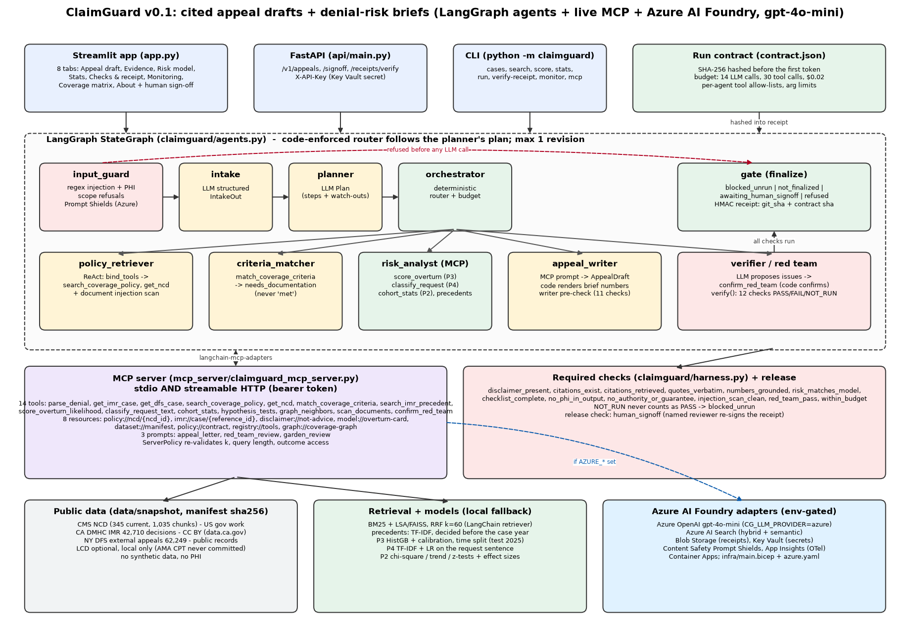

# ClaimGuard

**Cited appeal-letter drafts and denial-risk briefs for denied health-insurance claims.** ClaimGuard is an agentic RAG system built with
LangChain, LangGraph and a live MCP server, ready to run on Azure AI Foundry (gpt-4o-mini). It uses only public data: CMS Medicare
coverage policy and published independent-review decisions. Twelve code-enforced checks gate every draft, and a draft is released only after
a named human signs off.

> ClaimGuard drafts are not legal advice and not medical advice. ClaimGuard is not a law firm, a medical provider or a Medicare contractor. It never files,
> submits or sends an appeal. A qualified human must review and edit every draft. Statistics describe past published reviews and do not predict any individual appeal.

Integrative Industry Synthesis capstone (Project 7) and Project 8 defense - Sandip Dey. Version 0.1.0 (see [CHANGELOG](CHANGELOG.md)).



*The diagram is generated by `scripts/draw_architecture.py`. That script reads the tool, resource and prompt counts from the MCP server source and asserts them, so the figure cannot drift from the code.*

## What it does

The input is a denial: either a published CA DMHC IMR case (its outcome is held out from the agents) or de-identified text you paste in. ClaimGuard runs eight steps:

1. **input_guard.** Before any LLM call, it scans for prompt injection (regex, plus Azure Prompt Shields when configured), redacts PHI and refuses out-of-scope requests: invented patients, impersonation, guarantees and filing on someone's behalf.
2. **intake.** An LLM fills a structured `IntakeOut`: the service, the denial basis, the treatment category and search queries.
3. **planner.** An LLM writes a step plan. A code-enforced **orchestrator** then routes the specialists in plan order under a budget.
4. **policy_retriever.** A ReAct agent (`bind_tools`) calls the MCP tools `search_coverage_policy` and `get_ncd`. Search is hybrid: BM25 plus LSA/FAISS fused with RRF, or Azure AI Search. Retrieved text is scanned for indirect injection.
5. **criteria_matcher.** An LLM lists the policy criteria to document. The code never marks a criterion as "met".
6. **risk_analyst.** Deterministic MCP calls produce four signals:
   - the P3 overturn model;
   - the P4 request-text model;
   - P2 cohort statistics with a Wilson CI;
   - precedents decided **before** the case year (never the case itself).
7. **appeal_writer.** It uses an MCP prompt and returns an `AppealDraft`. Code renders every number in the brief, and a writer pre-check allows one revision.
8. **verifier.** The red team works on "LLM proposes, code confirms": an issue counts only if its quote is really in the draft and code verifies the rule. Then the 12 checks run, each PASS, FAIL or NOT_RUN. A **gate** sets the status:
   - `blocked_unrun`: a required check did not run (NOT_RUN never counts as a pass);
   - `not_finalized`: a required check failed;
   - `awaiting_human_signoff`: every check passed;
   - `refused`: the input guard stopped the run.

   It also signs an **HMAC receipt** that carries the git sha, the contract sha256, the data feed checksums, the check statuses and the cost. A human approval in the UI or API changes the status to `released` and re-signs the receipt.

Every limit lives in [`contract.json`](contract.json): the budget (14 LLM calls, 30 tool calls, 60k tokens, $0.02 and 240 s), per-agent tool allow-lists and tool argument limits. The contract is hashed into every receipt.

## Results (all numbers are from files in `eval/`)

**Live end-to-end runs.** These are 7 runs with gpt-4o-mini via Vocareum on real 2025 IMR cases, made after the first commit; each log has the receipt and git sha. Logs are in `eval/logs/` and the summary is in `eval/summary.json`.

| Case | Service (NCD) | Commit | Status | Latency | Cost | Overturn signal | Published outcome (held out) |
|---|---|---|---|---|---|---|---|
| MN25-45854 | insulin pump (NCD 280.14) | 3f04269 | awaiting_human_signoff, 12/12 PASS | 43.9 s | $0.0033 | 67.7% | Overturned |
| MN25-44606 | hyperbaric oxygen (NCD 20.29) | 3f04269 | awaiting_human_signoff, 12/12 PASS | 43.2 s | $0.0038 | 51.5% | Upheld |
| MN25-45013 | gastric bypass (NCD 100.1) | 3f04269 | awaiting_human_signoff, 12/12 PASS | 48.9 s | $0.0045 | 52.7% | Overturned |
| MN25-46141 | cochlear implant (NCD 50.3) | eb15f66 | awaiting_human_signoff, 12/12 PASS | 38.0 s | $0.0034 | 40.7% | Overturned |
| EI25-46125 | implantable CGM (no NCD) | eb15f66 | awaiting_human_signoff, 12/12 PASS | 57.1 s | $0.0048 | 72.5% | Upheld |
| MN25-45854 | insulin pump | eb15f66 | **not_finalized** (red_team_pass FAIL) | 65.1 s | $0.0050 | 67.7% | Overturned |
| MN25-44606 | hyperbaric oxygen | eb15f66 | **not_finalized** (red_team_pass FAIL) | 54.8 s | $0.0048 | 51.5% | Upheld |

- **Pass rates.** All 12 checks passed in 5 of 7 runs. Citation validity was 35/35 and checklist completeness was 7/7.
- **Why 2 runs were not finalized.** In both, the red-team LLM flagged sentences that were actually supported by the policy. The quotes were verbatim, but the reviewer does not see the policy text. Commit 3f04269 added two code confirmations: rule 2 now checks citation support and inline quotes, and rule 1 ignores statements that a fact is missing. After that, both cases finalized.
- **Spend.** Total live spend, including 5 pre-commit development runs in `eval/logs/dev/`, was **$0.051** at list price.

**Offline evaluation** (`scripts/run_eval.py`, $0):

- **Retrieval.** There are 292 real IMR request sentences, each labelled with an NCD by a keyword rule (17 services). Results at NCD-document level:

  | Mode | recall@1 | recall@3 | recall@5 | MRR@10 |
  |---|---|---|---|---|
  | BM25 | 0.880 | 0.983 | 0.990 | 0.932 |
  | LSA + FAISS | 0.945 | 0.986 | 0.990 | 0.963 |
  | Hybrid (served) | 0.921 | 0.990 | 0.990 | 0.954 |

- **Gate mutation test.** Each of the 5 passing live drafts got 8 injected faults: an invented citation, an invented number, an altered quote, a removed disclaimer, a guarantee, PHI, injection text and a removed requested action. The gate caught **40/40**. The first pass caught 39/40: an invented "93.7%" slipped through against a source value of 94, so number grounding is now rounding-aware.
- **Injection.** 16 adversarial prompts were blocked 16/16, with **0 false positives** on all 2,652 real 2025 IMR request sentences. The first pass blocked 12/16. Patterns were added afterwards, so 16/16 is an in-sample result.

**P3 overturn model** (`eval/model_report.json`). It predicts P(IMR overturns the denial) from pre-decision categories. The split is by time: train ≤2023 (36,727 rows), validation 2024 (2,715) and test 2025 (2,730).

- **Model choice.** On validation, HistGradientBoosting scored AUC 0.7276 against 0.7241 for logistic regression. HistGradientBoosting was refit on train plus validation with sigmoid calibration.
- **2025 test results:** ROC-AUC 0.7556, PR-AUC 0.8792, Brier 0.1814, recall 0.830, precision 0.819 and F1 0.825.
- **Baselines.** A smoothed subcategory-rate baseline scores AUC 0.7409. Predicting the majority class gives accuracy 0.7234; the model's accuracy is 0.7447.
- **Prior shift.** The overturn rate was 0.498 in training and 0.723 in 2025, so the calibrated model under-predicts in 2025. PSI on DiagnosisCategory is 0.91, a major shift.

**P4 text model** (`eval/text_model_report.json`). TF-IDF plus logistic regression on the pre-decision request sentence only:

- **Test results:** ROC-AUC 0.7476 and F1 0.816 (validation AUC 0.7053).
- **Leakage bound.** Using the full Findings text gives an AUC of 0.9951. That is a leakage upper bound, not served: the Findings state the decision.

**P2 statistics** (`eval/stats_results.json`, Bonferroni over 7 tests). Effect sizes are reported because, with tens of thousands of rows, tiny effects become "significant":

| Test | Result | Effect size |
|---|---|---|
| Overturn rate by treatment category (chi²) | 1200.4, dof 11, p=1.4e-250 | Cramér's V = 0.181 |
| By review type | χ² 312.4 | V = 0.086 |
| Cochran-Armitage trend 2015→2025 | z = 22.35; rate 0.515 → 0.723 | - |
| CA IMR vs NY DFS 2019-2025 | 0.629 vs 0.469, difference 0.161, 95% CI [0.152, 0.169] | Cohen's h = 0.324 |
| Medical necessity vs experimental | 0.549 vs 0.454 | h = 0.19 |
| NY DFS by denial reason | - | V = 0.025 (negligible) |
| NY DFS by coverage type | - | V = 0.218 |

**Quality gates.** The suite has 71 pytest tests. They run offline with a scripted fake gpt-4o-mini through the real LangGraph graph and the real MCP subprocess, plus a Streamlit AppTest. ruff and mypy are clean on 35 files. `scripts/verify_mcp.py` passes over stdio and streamable HTTP: 14 tools, server-policy refusals, and a 401 without the bearer token. The Bicep builds and lints clean.

## Capstone mapping (P1-P6)

| Project | Where in ClaimGuard | Evidence |
|---|---|---|
| **P6 Agentic AI (core)** | LangGraph StateGraph (`claimguard/agents.py`): planner → orchestrator ↔ 5 specialists → gate. ReAct with `bind_tools`, structured output and a LangChain `BaseRetriever`. MCP server with 14 tools, 8 resources and 3 prompts over stdio and HTTP (`mcp_server/`). 12-check verifier, red team, HMAC receipt, human sign-off, budgets and gardener | live runs, `tests/test_agents_e2e.py`, `scripts/verify_mcp.py` |
| **P3 Machine learning (core)** | `claimguard/models.py`: time-split HistGB vs LR, calibration, baselines; served via MCP `score_overturn_likelihood` | `eval/model_report.json`, Risk model tab |
| **P2 Statistics (core)** | `claimguard/stats.py`: chi-square + Cramér's V, Cochran-Armitage, two-proportion z + Cohen's h, Wilson CI, Bonferroni | `eval/stats_results.json`, Stats tab |
| P4 NLP / deep learning | `claimguard/text_model.py`: TF-IDF + LR on the request sentence, leakage bound; LSA embeddings for retrieval | `eval/text_model_report.json`; LSTM note in `notebooks/README.md` |
| P1 Python engineering | package + CLI (`python -m claimguard`), FastAPI, typed (mypy), linted (ruff), tested (pytest), Docker | `claimguard/cli.py`, `tests/` |
| P5 Data engineering | `scripts/fetch_data.py` → cleaning log → `data/snapshot` + sha256 manifest; drift monitoring (PSI) | `data/snapshot/manifest.json`, Monitoring tab |

Coverage against the course diagrams is in [docs/COVERAGE.md](docs/COVERAGE.md) and the app's Coverage matrix tab:

- knowledge graph: 34 nodes;
- AI Agent build: 37 items;
- LangGraph + MCP: 17 components.

## Data sources (public; no synthetic data, no PHI)

| Source | Rows used | License / terms | Link |
|---|---|---|---|
| CA DMHC Independent Medical Review determinations | 42,710 decisions (2001-2026; 2026 excluded from models) | Open data on data.ca.gov (Creative Commons Attribution); attribution: California Department of Managed Health Care | https://data.ca.gov/dataset/independent-medical-review-imr-determinations-trend |
| NY DFS External Appeal database | 62,249 appeals (2019-2026) | Public government records, NY Department of Financial Services; check the portal terms before commercial reuse | https://www.dfs.ny.gov/public-appeal/search |
| CMS Medicare Coverage Database - NCDs | 345 current NCDs → 1,034 chunks | U.S. federal government work; NCD narrative only | https://www.cms.gov/medicare-coverage-database/downloads/downloads.aspx |
| CMS Coverage API (NCD report) | 345 matched | U.S. federal government work | https://api.coverage.cms.gov/ |
| CMS LCDs (optional, `CG_INCLUDE_LCD=1`) | local index only | can reference AMA CPT / ADA CDT content: **never committed or redistributed** | same CMS page |

More detail is in [docs/DATA_SOURCES.md](docs/DATA_SOURCES.md). Raw files go to `data/raw/` (gitignored). The cleaned snapshot is committed with sha256 checksums, and every receipt carries the feed versions.

## Quick start

```bash
python -m venv .venv && source .venv/bin/activate
pip install -r requirements-dev.txt
python -m claimguard verify-snapshot          # data checksums
python -m pytest -q && python scripts/verify_mcp.py
cp .streamlit/secrets.toml.example .streamlit/secrets.toml   # add a gpt-4o-mini key (Vocareum/OpenAI-compatible or Azure OpenAI)
streamlit run app.py                          # 8 tabs; saved live runs open without a key
python scripts/live_run.py MN25-45854         # one live run (~$0.004)
uvicorn api.main:app --port 8000              # REST API (X-API-Key = CG_API_KEY)
python -m claimguard mcp --transport streamable-http --port 8765   # HTTP MCP server (bearer CG_MCP_TOKEN)
```

To refresh the data, run `python scripts/fetch_data.py`. To retrain and re-evaluate, run `python scripts/train_models.py && python scripts/run_eval.py`. `python scripts/garden.py` proposes fixes from the logs; it is propose-only.

## Azure AI Foundry

Set `CG_LLM_PROVIDER=azure` to use Azure OpenAI gpt-4o-mini. Authentication is Entra ID by default, or an API key if you provide one. Each other adapter is optional and switches on with its own env var:

| Adapter | Env var | Fallback when unset or failing |
|---|---|---|
| Azure AI Search (hybrid + semantic) | `AZURE_SEARCH_*` | local hybrid index |
| Blob Storage (receipts) | `AZURE_STORAGE_*` | local files |
| Content Safety Prompt Shields | `AZURE_CONTENT_SAFETY_ENDPOINT` | local regex scanner |
| App Insights (OpenTelemetry) | `APPLICATIONINSIGHTS_CONNECTION_STRING` | no export |

[`infra/`](infra) holds the Bicep that provisions the full stack: Foundry resource and project, a gpt-4o-mini GlobalStandard deployment, AI Search, Storage, Key Vault, ACR, Container Apps and App Insights. `azure.yaml` deploys it with `azd up`.

Deployment status: the Bicep builds and lints clean offline, and the adapters are tested against mocked endpoints. **Nothing has been deployed to Azure yet.** It needs your subscription; see [docs/AZURE_DEPLOY.md](docs/AZURE_DEPLOY.md).

## Limits (read before using)

- **What the signals are.** The risk signals are association statistics from published California commercial-plan reviews. They do not know the clinical record and are not a chance of winning. The model is only modestly better than the subcategory baseline (AUC 0.756 vs 0.741). It under-predicts in 2025 because of the prior shift.
- **Policy coverage.** NCDs are Medicare national policy. Commercial plans use their own criteria, so an NCD citation is supporting context, not the plan's rule. Some services, such as the implantable CGM case, have no NCD.
- **Red team.** The red-team LLM does not see the policy text, so it over-flags (it flagged 5 supported sentences in one run). Code confirmation drops what it cannot verify, and a future version should pass excerpts to the reviewer.
- **Evaluation size.** There are 7 live runs on 5 cases. That is an engineering demonstration, not a quality study. Retrieval labels are weak keyword labels, and the injection set is small and in-sample after the follow-up patterns.
- **PHI.** PHI detection is regex-based. Paste only de-identified text.
- **Receipts.** A receipt verifies only with the same `CG_RECEIPT_KEY` (HMAC). The app uses an ephemeral key if none is set.
- **Azure.** Not deployed yet. Before a paid deploy, check gpt-4o-mini regional availability, quotas and the Content Safety endpoint on the Foundry resource.

## Repository layout

`claimguard/` (package) · `mcp_server/` · `api/` · `app.py` · `scripts/` · `tests/` · `eval/` · `data/snapshot/` · `infra/` + `azure.yaml` · `docs/` · `ci/ci.yml` (add as `.github/workflows/ci.yml`, see `ci/README.md`).

MIT License (code). Data stays under its own terms (above).
